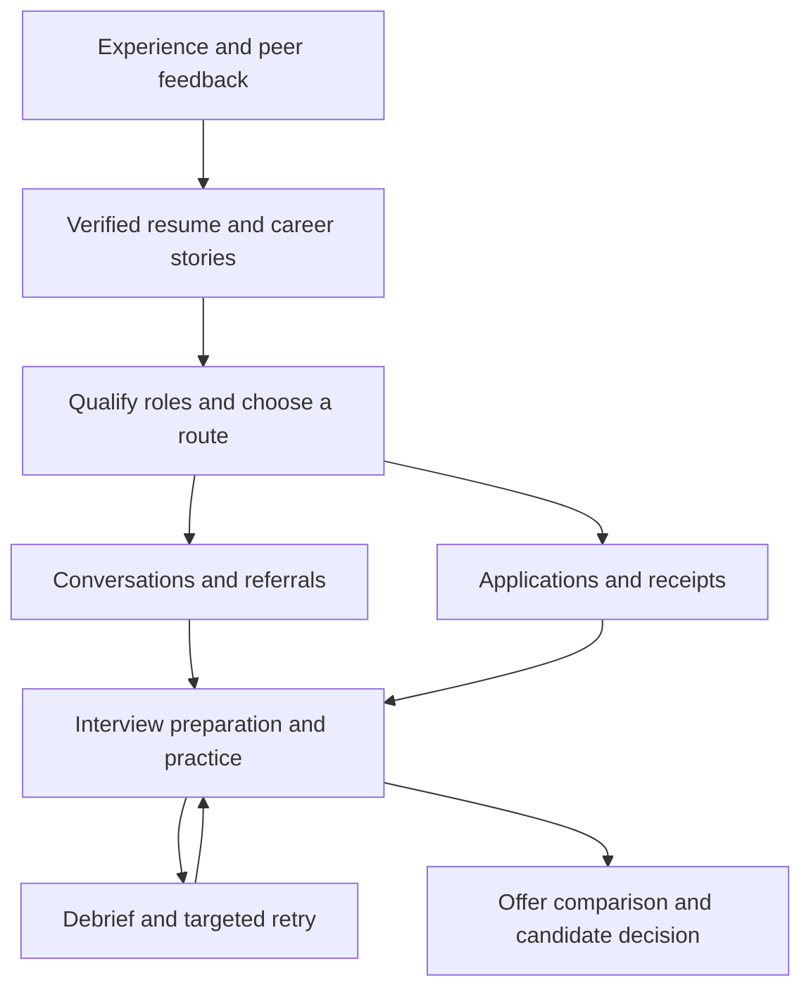

# Job Search Skills

**Run your job search with the AI agent you already use.**

Ten open-source skills connect your experience, resumes, opportunities, applications, conversations and interview preparation. Your agent helps with the work; your private records show what happened and what needs attention.

Start with one workflow or install the whole bundle. Designed for people comfortable using an AI agent with local files. Examples focus on product engineering, while candidate facts, countries, professions, languages and priorities remain configurable.

**[Download v0.2.0](https://github.com/shashu10/job-search-skills/releases/tag/v0.2.0)** · [Fictional walkthrough](examples/walkthrough.md) · [Validation](docs/VALIDATION.md) · [MIT license](LICENSE)

## Quick start

Download and extract the release, or clone this repository. With Python 3.10 or later, run this from the package root:

```sh
python3 skills/job-search-setup/scripts/init_workspace.py ../my-job-search --skills-dir ./skills
```

Open the new `my-job-search` folder in your agent and ask:

```text
Use job-search-setup to set up my search. Start with my resume and ask only
for missing preferences that affect which roles we should pursue.
```

The helper copies blank templates and all ten skills into a new private workspace outside this repository. It uses the Python standard library, makes no network calls, refuses existing destinations and creates no Git remote. Its generated `.gitignore` excludes workspace contents by default. Optional fields can remain unknown until needed.

Already have a job-search workspace? Ask setup to map your existing records. Do not run the initializer over them. Updating public skills never authorizes replacing your facts, history or permissions.

## Choose a workflow

| Skill | Use it for | Result |
| --- | --- | --- |
| [job-search-setup](skills/job-search-setup/SKILL.md) | Onboarding or mapping existing records | Private workspace, priorities and source ownership |
| [job-resume](skills/job-resume/SKILL.md) | Career evidence, peer feedback and resume tailoring | Supported claims, reviewed materials and preserved versions |
| [job-research](skills/job-research/SKILL.md) | Company discovery and exact-role qualification | Current openings, fit, uncertainties and useful routes |
| [recruiting-outreach](skills/recruiting-outreach/SKILL.md) | Contacts, referrals, drafts and authorized messages | Relevant conversations and recorded sends/replies |
| [job-application](skills/job-application/SKILL.md) | Completing or recovering authorized applications | Exact role, submitted material and receipt, or a precise blocker |
| [job-interview](skills/job-interview/SKILL.md) | Preparation, practice and debriefs | A focused plan and specific exercises for the next round |
| [job-offer](skills/job-offer/SKILL.md) | Offer comparisons and negotiation preparation | Cash/equity distinctions, tradeoffs and unresolved terms |
| [job-inbox](skills/job-inbox/SKILL.md) | Recruiting message review and reconciliation | Source-linked updates and honest coverage checkpoints |
| [job-pipeline-review](skills/job-pipeline-review/SKILL.md) | Quick priorities or full progress analysis | Reliable counts, source freshness and next actions |
| [job-search-schedule](skills/job-search-schedule/SKILL.md) | Requested reminders and recurring runs | Verified host configuration, or a clearly uncreated specification |

Each skill has a narrow trigger and loads supporting references only when needed. A standalone resume edit, interview session or offer comparison can use supplied documents without workspace setup.

## How the pieces connect



Shared records support every stage. Inbox reconciliation brings in new evidence, and pipeline review identifies what needs attention. A debrief can suggest a reusable improvement; it does not silently turn one employer's feedback into a permanent rule.

The [worked example](examples/walkthrough.md) follows a fictional candidate through a corrected resume, a referral hold, an application and interview preparation.

## Your records, separate from the package

```text
AGENTS.md                  Standing boundaries and workflow routing
references/                Confirmed profile, preferences and recordkeeping
roles/INDEX.md             Lanes and authoritative tracker mapping
roles/applications.md      Exact roles, grants, events, evidence and next actions
outreach/contacts.md       Contacts, referrals, drafts, sends and replies
resumes/INVENTORY.md       Reusable materials and submitted versions
interviews/INDEX.md        Links to preparation, practice and debriefs
offers/INDEX.md            Links to private offer comparisons
inbox/reviews.md           Coverage, checkpoints and unresolved messages
schedules/automations.md   Requested jobs, scope and verified host state
.agents/skills/            Installed workflows
```

One application has one authoritative history. Outreach has its own linked record. Start with one lane; split by country or owner only when useful. Summaries are dated views, not extra live trackers.

Corrections govern new claims while submitted materials remain intact. A referral request is not a completed referral. A filled form is not a confirmed submission. An elapsed booking is not evidence that an interview happened. The workflows preserve these distinctions and reuse existing authorization within its actual scope.

## Tools and compatibility

Skills are instructions, not a hosted service or browser automation engine. The executable helper initializes a workspace. External execution depends on your agent's tools, access and your authorization.

| Available capability | What the workflows can do |
| --- | --- |
| Local files and an AI agent | Work from supplied evidence, prepare drafts, practice and review records |
| Public search | Verify current roles and sources within the requested scope |
| Document tools | Render and inspect resume outputs; otherwise visual QA stays incomplete |
| Authorized mailbox access | Reconcile messages; otherwise analyze supplied exports with limited coverage |
| Authorized browser or provider tools | Complete supported external actions and verify the result |
| Host scheduler | Configure requested recurring work; otherwise provide an uncreated specification |

The initializer installs skills under `.agents/skills/`, a documented Codex discovery location. Other agents may use the `SKILL.md` files with their own loading conventions. Cross-host operation has not been comprehensively tested. See [official skill documentation](https://developers.openai.com/codex/skills).

For supported Codex plugin clients, this repository includes a portable manifest and repository marketplace:

```sh
codex plugin marketplace add shashu10/job-search-skills --ref v0.2.0
```

Then install Job Search Skills through the client's plugin browser and start a new session. Client support varies; the direct workspace initializer remains the simple local path. Repository distribution is separate from listing in the universal public Plugins Directory. See [official packaging documentation](https://developers.openai.com/plugins/build/plugins).

## Privacy and permissions

- The repository contains public procedures, blank templates and explicitly fictional examples. Keep completed records in the separate private workspace.
- There are no bundled accounts, credentials, connectors, telemetry, install hooks or automatically activated schedules.
- Installing a skill does not authorize applications, messages, purchases or background work. Existing grants are reused within scope, with later holds and corrections respected.
- Local storage does not mean offline AI: your chosen model and connected services receive data you send to them. Review their settings and access separately.
- Instructions cannot guarantee enforcement across every agent or tool. The package does not promise hiring outcomes, universal portal support or automatic compliance with employer assessment rules.

## Development and validation

```sh
python3 scripts/check_package.py
python3 -m unittest discover -s tests -v
```

Checks cover structure, routing links, metadata, blank templates, initialization boundaries and representative privacy leaks. They do not replace a manual release review. [Independent scenarios](tests/scenarios/README.md) exercise decisions with fictional inputs; [validation notes](docs/VALIDATION.md) describe the checks and their limits.

Read [CONTRIBUTING.md](CONTRIBUTING.md) before contributing; never attach private records to a public issue or pull request.

## Roadmap

The optional dashboard, machine-readable record API and provider adapters are future work. v0.2.0 is the ten-skill workflow package with a private-workspace initializer. See [the release plan](docs/RELEASE_PLAN.md) and [changelog](CHANGELOG.md).
