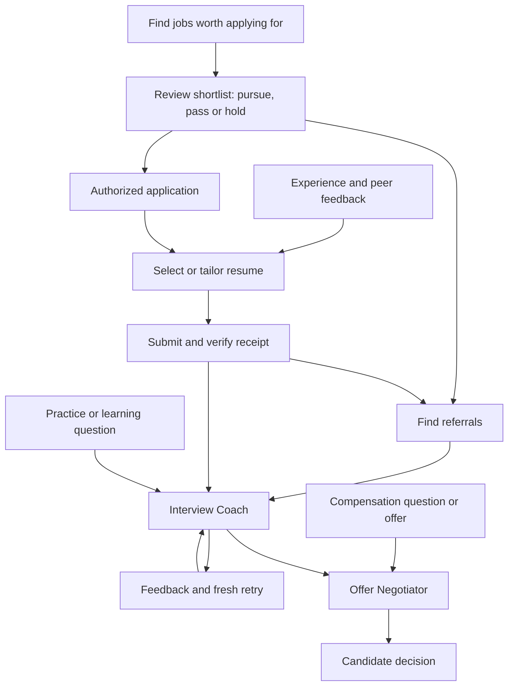

# Job Search Skills

**Find worthwhile jobs, find referrals, practice interviews and negotiate offers with the AI agent you already use.**

Four everyday entry points connect your search. Ten open-source skills support them with resume preparation, applications, private records and follow-through. Ask in ordinary language; you do not need to learn the internal skill names.

Start with one workflow or install the whole bundle. Designed for people comfortable using an AI agent with local files. Examples focus on product engineering, while candidate facts, countries, professions, languages and priorities remain configurable.

**[Download v0.3.0](https://github.com/shashu10/job-search-skills/releases/tag/v0.3.0)** · [Fictional walkthrough](examples/walkthrough.md) · [Validation](docs/VALIDATION.md) · [MIT license](LICENSE)

## Start with what you need

| Entry point | Try asking | What you get |
| --- | --- | --- |
| [Find Jobs Worth Applying For](skills/job-research/SKILL.md) | “Find jobs worth applying for. Give me a shortlist to review.” | Verified openings, fit and gaps, suggested routes, and your pursue/pass/hold decisions |
| [Find Referrals](skills/recruiting-outreach/SKILL.md) | “Find referral routes for the jobs I've applied to. Start with people I know.” | Personal contacts, existing connections and relevant public contacts, with evidence and suggested requests |
| [Interview Coach](skills/job-interview/SKILL.md) | “Coach me on system design,” or “Review this project story.” | Explanations, reviews, mocks, focused preparation and feedback with a fresh retry |
| [Offer Negotiator](skills/job-offer/SKILL.md) | “A recruiter asked my salary expectations,” or “Help me negotiate this offer.” | Compensation scenarios, negotiation strategy and rehearsal, and decisions grounded in your priorities |

These are examples of intent, not required keywords. Interview coaching works before an invitation; negotiation support works before an offer. A narrow question needs only the relevant context. Tool access determines which sources the agent can actually inspect.

Review the shortlist, then say what to pursue, pass or hold. “Apply to these approved roles” starts application work within your authorization: select a suitable resume, tailor it when needed, complete the form and retain the receipt. Your interest in a role alone is not submission permission. Existing explicit grants are reused within their scope.

## Quick start

Download and extract the release, or clone this repository. With Python 3.10 or later, run this from the package root:

```sh
python3 skills/job-search-setup/scripts/init_workspace.py ../my-job-search --skills-dir ./skills
```

Open the new `my-job-search` folder in your agent and ask:

```text
Help me find jobs worth applying for. Start with my resume and ask only
for missing preferences that affect which roles to recommend. Let me review
the shortlist before applying.
```

The helper copies blank templates and all ten skills into a new private workspace outside this repository. It uses the Python standard library, makes no network calls, refuses existing destinations and creates no Git remote. Its generated `.gitignore` excludes workspace contents by default. Optional fields can remain unknown until needed.

Already have a job-search workspace? Ask setup to map your existing records. Do not run the initializer over them. Updating public skills never authorizes replacing your facts, history or permissions.

## Supporting workflows and stable skill names

The four entry points use the existing IDs `job-research`, `recruiting-outreach`, `job-interview` and `job-offer`. Existing explicit invocations and folder paths continue to work. Supporting skills remain discoverable and can also be requested directly:

| Supporting skill | When it helps |
| --- | --- |
| [job-search-setup](skills/job-search-setup/SKILL.md) | Map existing records or establish the private workspace and missing preferences |
| [job-resume](skills/job-resume/SKILL.md) | Review experience and peer feedback; select or tailor accurate application materials |
| [job-application](skills/job-application/SKILL.md) | Complete authorized applications, invoke resume work when needed and verify receipts |
| [job-inbox](skills/job-inbox/SKILL.md) | Reconcile recruiting replies and identify interview or offer next steps |
| [job-pipeline-review](skills/job-pipeline-review/SKILL.md) | Answer “What needs my attention?” or analyze progress |
| [job-search-schedule](skills/job-search-schedule/SKILL.md) | Configure requested reminders or recurring work through an available host scheduler |

Skills load supporting references only when needed. Supplied materials are enough for a standalone resume edit, coaching session or compensation question; workspace setup is not a prerequisite for those tasks.

## How the pieces connect



Shared records support every stage. Inbox reconciliation brings in new evidence, and pipeline review identifies what needs attention. A debrief can suggest a reusable improvement; it does not silently turn one employer's feedback into a permanent rule.

The [worked example](examples/walkthrough.md) follows a fictional candidate through shortlist decisions, resume support, referral routes, practice and compensation questions.

## Your records, separate from the package

```text
AGENTS.md                  Standing boundaries and workflow routing
references/                Confirmed profile, preferences and recordkeeping
roles/INDEX.md             Lanes and authoritative tracker mapping
roles/applications.md      Exact roles, grants, events, evidence and next actions
outreach/contacts.md       Contacts, referrals, drafts, sends and replies
resumes/INVENTORY.md       Reusable materials and submitted versions
interviews/INDEX.md        Links to preparation, practice and debriefs
offers/INDEX.md            Links to private offer comparisons
inbox/reviews.md           Coverage, checkpoints and unresolved messages
schedules/automations.md   Requested jobs, scope and verified host state
.agents/skills/            Installed workflows
```

One application has one authoritative history. Outreach has its own linked record. Start with one lane; split by country or owner only when useful. Summaries are dated views, not extra live trackers.

Corrections govern new claims while submitted materials remain intact. A referral request is not a completed referral. A filled form is not a confirmed submission. An elapsed booking is not evidence that an interview happened. The workflows preserve these distinctions and reuse existing authorization within its actual scope.

## Tools and compatibility

Skills are instructions, not a hosted service or browser automation engine. The executable helper initializes a workspace. External execution depends on your agent's tools, access and your authorization.

| Available capability | What the workflows can do |
| --- | --- |
| Local files and an AI agent | Work from supplied evidence, prepare drafts, practice and review records |
| Public search | Verify current roles and sources within the requested scope |
| Document tools | Render and inspect resume outputs; otherwise visual QA stays incomplete |
| Authorized mailbox access | Reconcile messages; otherwise analyze supplied exports with limited coverage |
| Authorized browser or provider tools | Complete supported external actions and verify the result |
| Host scheduler | Configure requested recurring work; otherwise provide an uncreated specification |

The initializer installs skills under `.agents/skills/`, a documented Codex discovery location. Other agents may use the `SKILL.md` files with their own loading conventions. Cross-host operation has not been comprehensively tested. See [official skill documentation](https://developers.openai.com/codex/skills).

For supported Codex plugin clients, this repository includes a portable manifest and repository marketplace:

```sh
codex plugin marketplace add shashu10/job-search-skills --ref v0.3.0
```

Then install Job Search Skills through the client's plugin browser and start a new session. Client support varies; the direct workspace initializer remains the simple local path. Repository distribution is separate from listing in the universal public Plugins Directory. See [official packaging documentation](https://developers.openai.com/plugins/build/plugins).

### Updating from v0.2.0

Skill IDs and the private-workspace layout remain compatible. Update through your plugin client, or replace only the matching installed skill folders from the new release. Preserve private records and custom instructions; do not rerun the initializer over an existing workspace. The revised blank workspace router is a reference for merging the new entry-point descriptions into an existing `AGENTS.md`, not a replacement for personal rules. Host clients may display the full ten-skill catalog even though this guide leads with four entry points.

## Privacy and permissions

- The repository contains public procedures, blank templates and explicitly fictional examples. Keep completed records in the separate private workspace.
- There are no bundled accounts, credentials, connectors, telemetry, install hooks or automatically activated schedules.
- Installing a skill does not authorize applications, messages, purchases or background work. Existing grants are reused within scope, with later holds and corrections respected.
- Local storage does not mean offline AI: your chosen model and connected services receive data you send to them. Review their settings and access separately.
- Instructions cannot guarantee enforcement across every agent or tool. The package does not promise hiring outcomes, universal portal support or automatic compliance with employer assessment rules.

## Development and validation

```sh
python3 scripts/check_package.py
python3 -m unittest discover -s tests -v
```

Checks cover structure, routing links, metadata, blank templates, initialization boundaries and representative privacy leaks. They do not replace a manual release review. [Independent scenarios](tests/scenarios/README.md) exercise decisions with fictional inputs; [validation notes](docs/VALIDATION.md) describe the checks and their limits.

Read [CONTRIBUTING.md](CONTRIBUTING.md) before contributing; never attach private records to a public issue or pull request.

## Roadmap

The optional dashboard, machine-readable record API and provider adapters are future work. v0.3.0 exposes four everyday entry points backed by ten skills and a private-workspace initializer. See [the release plan](docs/RELEASE_PLAN.md) and [changelog](CHANGELOG.md).
